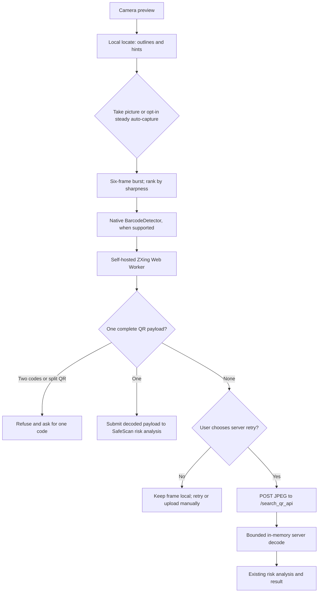

# QR scanning architecture and operations

This guide describes the web scanner in the camera upgrade. It combines the
already merged local worker and camera controls with the server decoder and
capture/fallback changes in scanner Phase 1 and Phase 4. **Publish it only with
those runtime changes.** Confirm the deployed commit includes the relevant
branches before treating the Phase 4 behavior below as live. The separate
React Native app has its own scanner implementation.

## Request flow



The live locate loop uses a reduced frame only for on-device guidance. It never
submits a decoded value. Auto-capture starts **off** on every scanner opening;
the user can arm it, and it fires only after one valid code remains steady over
multiple observations. Both manual and auto-capture use the same burst and
ambiguity checks. The reticle is a positioning hint; capture decodes the whole
frame. A successful local decode submits the **decoded payload**, not the
camera image, through the existing scan form. Scanning does not open the QR
destination automatically.

On local failure, the user can explicitly choose **Send photo to SafeScan**.
The scanner sends the sharpest frame as a JPEG (quality 0.92, long side at most
1920 pixels) to the guest-accessible `/search_qr_api` upload path with
`capture_source=camera_frame`. It does not offer this retry after a known
multi-code or Structured Append refusal. The server also receives images from
the normal upload form and from the authenticated `/api/scan/file` route.

## Browser decoder

`static/qr-camera.js` manages camera permission, stream lifecycle, capture,
guidance, and user consent. It requests 1920×1080 when possible, retries with
less demanding constraints, and exposes camera switching, zoom, focus, and
torch only when the browser and device report support. Tracks stop when the
page is hidden or closed. `static/qr-worker.js` runs the pinned, self-hosted
ZXing reader and WebAssembly under `static/vendor/zxing-wasm/3.1.6/`.
`BarcodeDetector` is a fast first pass where it supports QR; the worker still
checks the frame before a result can be accepted. There is no jsQR CDN loader.

The worker's option sets are shared with the client benchmark in
`static/qr-decode-options.json`:

| Mode | Formats | Options |
| --- | --- | --- |
| `locate` | QR, Micro QR, rMQR | `tryHarder: false`, `tryDownscale: true`, `maxNumberOfSymbols: 4`, `returnErrors: true` |
| `capture` | QR, Micro QR, rMQR | `tryHarder`, `tryRotate`, `tryInvert`, `tryDownscale`, `tryDenoise`: `true`; `maxNumberOfSymbols: 4`; `textMode: Plain` |

For each captured frame, the worker tries the full captured frame, a hinted or detected
region of interest, five overlapping 2× tiles, then three thresholds (70, 115,
155) if needed. The burst caps each frame at 3 megapixels to bound memory;
there is no unconditional 720-pixel downscale. It checks other symbol
locations before accepting a result.
The camera ranks up to six frames by a small grayscale sharpness sample and compares
payloads across frames. A different payload in another frame, two physical
codes in one frame, or a reported Structured Append fragment causes refusal.
Where supported, `ImageCapture.takePhoto()` is a final **local** attempt after
the video burst fails. A single frame can still miss a partially hidden code;
the user should aim at one visible code.

## Server decoder and limits

The Phase 1 server implementation uses `zxing-cpp==3.1.1` and runs upload
decoding in a thread pool behind `QR_DECODE_CONCURRENCY` (default 2). Each
production upload runs in a killable child process, so a native C++ stall cannot
hold an upload worker indefinitely. The internal tier deadline is
`QR_DECODE_BUDGET_S` (default 1.5 seconds); the parent enforces a wall limit of
that budget plus one second for an image or 3.5 seconds for a PDF. Direct
internal calls to `decode_qr_image()` still use the soft tier deadline. The
decoder reads EXIF orientation and rejects images over 40 megapixels. Monitor
latency and memory on Render, particularly for pathological images.

| Order | Tier | Purpose |
| --- | --- | --- |
| A | ZXing at native grayscale resolution | General detection, including Micro QR and rMQR |
| B | ZXing after 2× bicubic upscale when the working image is under 1600 pixels on its long side | Small or distant codes |
| C | pyzbar on the working grayscale image | Independent second opinion |
| D | OpenCV WeChat QR, only if `QR_WECHAT_ENABLED=true` | Optional difficult-image decoder; default off |
| E | Autocontrast, sharpen, contrast, low thresholds, and 1400-pixel upscale; ZXing binarizers then pyzbar | Stylized and low-contrast fallback |

For images over 4000 pixels on the long side, Tier A first sees native
resolution; subsequent tiers use a half-size working copy. Tier E preserves
thresholds 55, 70, and 85 for stylized codes. The first successful tier returns
its detected symbols; multiple symbols cause an ambiguity error. Each tier
records `safescan_qr_decode_total{tier,outcome}` and the full decode records
`safescan_qr_decode_seconds`. Metric labels do not contain payloads or images.
The optional WeChat decoder and model files ship disabled; enable only after a
measured read-rate gain and acceptable memory/cold-start cost on Render.

The Phase 4 upload guard limits the complete multipart request to
`MAX_QR_UPLOAD_BYTES` (default 8 MiB) plus 64 KiB of form overhead before form
parsing. It bounds concurrent upload requests to three, allows at most two
active uploads per visitor, and enforces a 15-second body-read deadline. A
90-request/15-minute budget is keyed to Render's edge-authored client IP when
available, without trusting a caller's `X-Forwarded-For`. These are
per-process controls; use a shared limiter before scaling to multiple
instances. The multipart spool threshold is raised above the request cap so
scanner uploads do not spill to a disk file.

## Privacy and retention

- The camera preview, locate frames, burst frames, and local decode run in the
  browser. No third-party script or decoder CDN is loaded for scanning.
- A successful local read sends the **decoded payload** to SafeScan for risk
  analysis. URL reputation and other configured providers may receive URL data
  according to the published Privacy Policy; PhishTank matching
  uses a local feed. A QR image is not sent in the local-success path.
- A failed local read sends a JPEG **only after the user clicks the server
  retry button**. The server decodes that image in memory and does not call the
  upload-artifact storage path. Scanner responses use `Cache-Control: no-store`.
  This is request-time image handling, not a promise that no scan data is kept.
- Signed-in users' decoded scan results and counters can remain in account
  history until deletion or account removal. Private non-URL payloads use
  private storage references rather than raw secrets. Guests do not get an
  account scan-history row. The server audit log records scan metadata, not the
  JPEG bytes.
- Decoder metrics contain tier, outcome, and duration. Do not add payloads,
  images, device IDs, or URLs to labels. With `SCANNER_V3=true` and a current
  **Accept All** analytics choice, the browser sends fixed-category scanner
  counts to `/api/telemetry/scan`; the server
  aggregates them into counters and discards individual events. The event
  contains no QR text, photo, device identifier, session cookie, or free-form
  guidance message.

The published Privacy Policy and in-app camera copy describe the consented
image transfer and aggregate performance counts.

## Benchmarks and corpus maintenance

Run from the repository root. Python dependencies come from `requirements.txt`;
Node 20.9+ is required for the benchmark tooling only. The website has no
frontend build step.

```bash
python3 scripts/qr_bench/make_synthetic.py
python3 scripts/qr_bench/bench_server.py --corpus synthetic
cd scripts/qr_bench && npm ci && cd ../..
node scripts/qr_bench/bench_client.mjs --corpus synthetic
python3 scripts/qr_bench/fetch_boofcv.py
python3 scripts/qr_bench/bench_server.py --corpus boofcv
node scripts/qr_bench/bench_client.mjs --corpus boofcv
```

Use `--limit N` on either benchmark for a quick category-spread sample. The
client benchmark also accepts `--min N` as a regression floor. Full JSON reports
go under ignored `.cache/qr_bench/`; they include filenames, outcomes, and
timings, not payloads or image bytes. Compare before/after runs on the same
machine and record both exact synthetic matches and per-category real-photo
read rates. BoofCV's detection labels are coordinates rather than payload text,
so its read rate means at least one valid QR was found, not an exact-text match.
See `scripts/qr_bench/README.md` for the recorded Phase 0 baseline and dataset
checksum.

To add a **synthetic** case, edit `build_cases()` in
`scripts/qr_bench/make_synthetic.py`, add the scene with every physical QR
payload in its label list, regenerate the PNGs and `labels.json`, and inspect
the output image. Multi-code labels must list both payloads even when one is
partly covered. Run the server and client benchmarks plus
`tests/test_qr_corpus_regression.py`; update the regression floor only when a
reproducible improvement is established. Keep test images free of real user
payloads. For a **real photo**, obtain permission and remove private context
before storing it in a corpus; keep licensed third-party datasets in ignored
`.cache/qr_corpus/`, not Git.

```bash
python3 -m pytest tests/test_qr_corpus_regression.py -q
```

## Known limits and release checks

- Strong curvature and motion blur still defeat decoders. Burst selection,
  zoom, focus, lighting, and guidance improve the capture opportunity but do
  not guarantee a read.
- The browser worker can identify Structured Append metadata and refuse split
  QR fragments. The pinned Python `zxing-cpp` binding does not expose the same
  metadata, so a consented server upload cannot yet make an equivalent
  Structured Append check. Keep this gap visible in release review.
- A decoder can miss a second physical code, especially a partly covered
  sticker. Never treat a single decoded result as proof that no other QR exists.
- The synthetic and BoofCV benchmarks are not a substitute for the device
  matrix in `docs/plans/camera-scanning-v3.md`. Record iPhone Safari, Android
  Chrome/Firefox, Samsung Internet, and desktop webcam results before claiming
  first-try gains in production. A complete field device matrix has not yet
  been recorded for this release.

Check the release on a fresh browser session: worker and `.wasm` load from
`/static/` with the expected MIME type; the CSP has no jsdelivr origin; manual
and auto-capture refuse two-code scenes; server retry requires a click; the
upload rejects oversize requests; and a camera-frame request creates no image
artifact. `SCANNER_V3` defaults to `false`, serving the preserved Phase 3
self-hosted scanner. Enable it only after checking the Phase 4 camera on the
live service, and set it back to `false` to roll back the browser behavior.
Check actual Render latency and memory before enabling WeChat.
